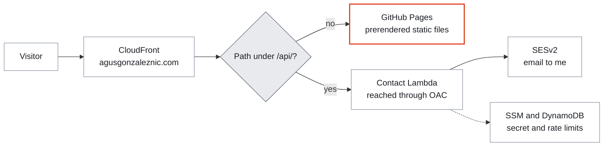
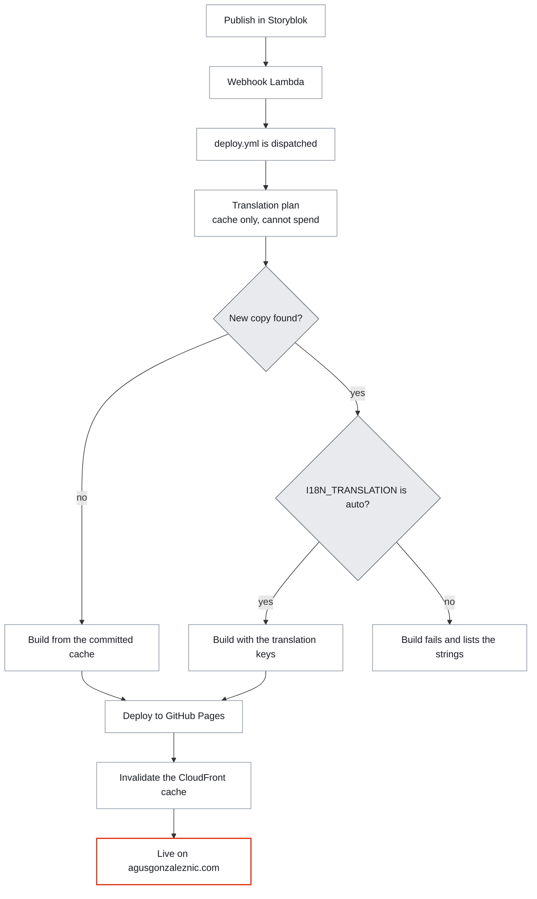

<div align="center">


# 🌐 agusgonzaleznic.com

### My personal site and blog, prerendered, in six languages, with its infrastructure in code.

**The source of [agusgonzaleznic.com](https://agusgonzaleznic.com), where I write about engineering
leadership and offer coaching.** A React app that is rendered to static HTML for every route and
every language, served from GitHub Pages behind a CloudFront CDN. The blog and the marketing pages
live in Storyblok and are pulled in at build time. The contact form, DNS, TLS, email and the
pipelines are all defined in this repository.

<br>

[](https://agusgonzaleznic.com)


<br>


<br>

**[What this is](#-what-this-is) · [Quick start](#-quick-start) · [How it fits together](#how-it-fits-together) · [Languages](#-six-languages) · [Contact form](#the-contact-form) · [Security](#-security-and-privacy) · [Tech stack](#-tech-stack) · [Development](#-development) · [Deployment](#-deployment-and-ci) · [Infrastructure](#infrastructure) · [Structure](#-project-structure) · [Publishing](#writing-and-publishing) · [Working on it](#-working-on-it) · [Support](#-support) · [Licence](#-licence)**

</div>

---

## 🧭 What this is

It's the site I run my coaching practice from, and I built it to behave like a document first and an
app second. Every route is rendered to plain HTML at build time, once per language, so a reader or a
crawler gets the full page without running any JavaScript. React then takes over in the browser for
navigation.

| Piece | What it does |
|---|---|
| Static pages | `vite build` plus a server build feed `scripts/prerender.mjs`, which renders every route for every published language, with its own title, meta tags, canonical URL, hreflang links and JSON-LD |
| Content | Blog posts and marketing pages are written in Storyblok and fetched at build time. The running site never calls the CMS |
| Languages | English at the root, German, Spanish, French, Italian and Portuguese under `/{locale}/` |
| Contact form | A same-origin `/api/contact` endpoint (a Lambda behind CloudFront) that runs ten anti-abuse controls in order, then emails me through SESv2 |
| Analytics | Off by default. It loads only after a visitor opts in |
| Infrastructure | DNS, TLS, CDN, email and the serverless pieces are Terraform, applied by gated pipelines |

The reasoning behind these choices is in [`docs/architecture.md`](docs/architecture.md).

### What it does not do

| It doesn't | Why it matters |
|---|---|
| Call the CMS from the browser | The Storyblok token is build-time only. A build with any `VITE_STORYBLOK_*` variable set fails before it can reach the bundle |
| Serve a 200 for an unknown path | Unknown paths get a real HTTP 404 from `dist/404.html`, so search engines never see soft 404s |
| Load a third-party script at page load | Cloudflare Turnstile loads only when someone interacts with the contact form |
| Request fonts from anywhere else | Inter and Playfair Display are self-hosted in `public/fonts/` with `font-display: optional` |
| Relay contact mail through a third party | The Lambda sends through SESv2 directly |
| Publish every translation by itself | German and Spanish appear only after I've reviewed them. French, Italian and Portuguese publish automatically and say they are machine translated |

---

## ⚡ Quick start

You need Node.js 22, the version CI uses.

```bash
git clone https://github.com/agusgonzaleznic/agusgonzaleznic.github.io.git
cd agusgonzaleznic.github.io
npm ci
npx husky                                  # installs the pre-commit lint hook
npm run fetch-blog && npm run fetch-pages
npm run dev                                # http://localhost:8080
```

`.npmrc` saves exact versions and sets `ignore-scripts=true`, so npm runs no lifecycle scripts:
`npm ci` doesn't install the hook and `npm run dev` doesn't fetch content by itself. The two middle
lines do both. Without a Storyblok token the blog is empty and the marketing pages use the fallback
copy that lives in the section components, so everything else works without a single secret. To
build the way pull-request CI does, with a sample blog and no token:

```bash
BLOG_FIXTURE=1 npm run build
```

---

<a id="how-it-fits-together"></a>

## 🏗️ How it fits together

A request takes one of two paths. Everything except `/api/*` is a static file.



A publish in Storyblok rebuilds the site. The deploy first asks whether any copy needs paying for to
translate, and it can only spend when I've switched that on.



A push to `main` runs the same pipeline without the webhook, unless it changes only files
`deploy.yml` ignores (Terraform, Markdown and a few config files).

---

## 🌍 Six languages

English is the source and lives at the root. The other five sit under a path prefix, and all six are
published as of 14 November 2026.

| Language | URL | How its content reaches readers |
|---|---|---|
| English | `/` | Source, always published |
| German | `/de/` | Review-gated: a variant is emitted only after I approve it, and only while it still matches the English source |
| Spanish | `/es/` | Review-gated, like German |
| French | `/fr/` | Translated at build time, with a machine translation notice on articles |
| Italian | `/it/` | Translated at build time, with a notice |
| Portuguese | `/pt/` | Translated at build time, with a notice |

- **Interface strings** go through Lingui catalogs in `src/i18n/catalogs/`. The `.po` files are the
  committed source of truth.
- **CMS content** is translated at build time by DeepL, then an automated post-edit pass applies the
  site's voice. Results are cached by content hash in `scripts/.i18n-cache.json`, which is committed,
  so unchanged English is never translated twice.
- **Publishing is gated twice.** `PUBLISHED_LOCALES` in `src/i18n/locales.ts` switches a language on
  for the whole site, and `scripts/lib/blog-gate.mjs` decides per article which variants exist.
- **hreflang stays reciprocal.** The same approval list drives which pages are emitted, which
  alternates they advertise and which sitemap entries exist.

Details and the traps are in [`docs/architecture.md`](docs/architecture.md#i18n).

---

<a id="the-contact-form"></a>

## ✉️ The contact form

The form posts to `/api/contact`, a Lambda behind CloudFront. It runs these controls in this order
and stops at the first one that fails. The limits below are the constants in
`terraform/contact-lambda-src/index.mjs` as of 14 November 2026.

| Order | Control | What it checks |
|:--:|---|---|
| 1 | Method gate | Only `POST`, plus the `OPTIONS` preflight |
| 2 | CORS allowlist | The origin must be on the list, never `*` |
| 3 | Body size | At most 16,384 bytes, rejected before the JSON is parsed |
| 4 | Schema validation | Field shapes and lengths, with a 4,000-character message limit |
| 5 | Honeypot | A filled hidden field gets a silent success and no email |
| 6 | Burst limits | 5 requests per IP and 60 in total per 10 minutes, both before the Turnstile call |
| 7 | Turnstile verification | The token is verified with Cloudflare |
| 8 | Token checks | Not older than 300 seconds, not faster than 3 seconds, never reused |
| 9 | Per-email limit | 3 messages per email address per hour |
| 10 | Duplicate suppression | The same email and message within 24 hours is accepted but not sent again |

Then it emails me with the sender in `Reply-To`. A delivery failure returns a 502 instead of pretending
it worked. Rate-limit state is in DynamoDB and the Turnstile secret is in SSM. The tests for all of it
are in `terraform/contact-lambda-src/index.test.mjs`.

---

## 🔒 Security and privacy

This is a public repository and everything it prints is world-readable, so secrets never go in the
repo, the bundle, the build logs or a pull request.

| Rule | How it's enforced |
|---|---|
| No CMS token in the bundle | `scripts/assert-no-client-secrets.mjs` runs first in `npm run build` and fails if any `VITE_STORYBLOK_*` variable is set |
| Analytics only after opt-in | `src/lib/analytics.ts` injects no script until the visitor accepts. With no measurement ID configured the feature is off entirely |
| Turnstile only on interaction | `src/lib/turnstile.ts` loads Cloudflare's script on the first interaction with the form |
| Content Security Policy | Set by CloudFront's response headers policy in `terraform/cdn.tf` |
| Production stays reachable | `.github/workflows/synthetic.yml` probes the live site twice a day (see [deployment](#-deployment-and-ci)) |

To report a vulnerability, use the
**[shared security policy](https://github.com/agusgonzaleznic/.github/blob/main/SECURITY.md)**.

---

## 🧰 Tech stack

Versions are from `package.json` on `main` as of 14 November 2026.

| Layer | What I use |
|---|---|
| Build | Vite 8, React 19, TypeScript 7 for the type check (SWC for the build) |
| Styling | Tailwind CSS 4 with the config in `src/index.css`, shadcn/ui on Radix primitives, lucide-react icons |
| Routing and head | React Router 7, react-helmet for per-route metadata |
| Content | `@storyblok/react` 7, fetched at build time |
| i18n | Lingui 6 with `.po` catalogs, DeepL for machine translation |
| Quality gates | ESLint 10, Husky with lint-staged on commit, Playwright 1 for the browser suite |
| Dependencies | Dependabot, weekly, with a seven day wait on new releases |
| Infrastructure | Terraform, AWS (Route53, ACM, CloudFront, S3, SESv2, Lambda, DynamoDB, SSM), Cloudflare Turnstile |

The design colours live only in `src/index.css`. `npm run brand:check` fails CI on any colour that
isn't one of its tokens.

---

## 🧪 Development

### Scripts

| Command | What it does |
|---|---|
| `npm run dev` | Dev server on port 8080. Run `fetch-blog` and `fetch-pages` before it, since `.npmrc` stops its `predev` hook |
| `npm run build` | The full production build, in the order below |
| `npm run preview` | Serves the built `dist/` locally |
| `npm run lint` | ESLint with zero warnings allowed |
| `npm run typecheck` | Type-checks both TypeScript projects and fails if one resolves too few files to be meaningful |
| `npm run i18n:check` | Fails if a message is missing from the Lingui catalogs |
| `npm run i18n:extract` and `npm run i18n:compile` | Lingui catalog maintenance |
| `npm run brand:check` | Fails on any colour outside the design tokens or a broken contrast floor |
| `npm run assert-no-em-dash` | Fails on a forbidden dash in any tracked text file |
| `npm run test:e2e` | The browser suite against the built `dist/` (run the build first) |

`npm run build` runs these in order:

1. `assert-no-client-secrets` stops the build if a `VITE_STORYBLOK_*` variable is present.
2. `fetch-blog` pulls published posts from Storyblok into `src/generated/` and translates them per
   language.
3. `fetch-pages` does the same for the marketing pages.
4. `typecheck` type-checks the project.
5. `build:client` and `build:server` run the two Vite builds.
6. `prerender` renders every route for every published language, then writes the sitemap, the RSS
   feed and the real `404.html`.

### Environment variables

All of them are optional for local work. Provide them inline or from your own secrets manager, and
never commit a real value.

| Variable | Purpose | Notes |
|---|---|---|
| `STORYBLOK_PUBLIC_TOKEN` | Build-time read access to published content | Never `VITE_`-prefixed, so it can't be bundled. Production deploys set `STORYBLOK_REQUIRE_TOKEN=1`, so a deploy can't ship an empty blog |
| `STORYBLOK_VERSION` | Set to `draft` to preview unpublished content | Needs a preview token |
| `STORYBLOK_REQUIRE_TOKEN` | Set to `1` to fail the build when the token is missing | Set in the deploy workflow |
| `BLOG_FIXTURE` | Set to `1` to build from `content/fixtures/blog-fixture.json` | What pull-request CI uses, since it can't read secrets |
| `DEEPL_API_KEY` | Machine translation at build time | Build-time only, never `VITE_`-prefixed. Empty means the build never calls DeepL |
| `VITE_TURNSTILE_SITE_KEY` | Public Turnstile site key | Empty means the form can't be sent, and once a visitor starts on it, it asks them to email instead |
| `VITE_GA_MEASUREMENT_ID` | Turns on consent-gated analytics | Public by nature. Empty means analytics is fully off |
| `VITE_HTTPS` | Set to `true` for an mkcert HTTPS dev server | Only needed for the Storyblok Visual Editor preview |

`.env.example` has the full commented list.

### Tests and checks

| Check | Command | Where it runs |
|---|---|---|
| Lint, catalogs, brand tokens | `npm run lint && npm run i18n:check && npm run brand:check` | Every pull request that changes site files |
| Build and type check | `BLOG_FIXTURE=1 npm run build` | Every pull request that changes site files |
| Browser suite | `npm run build`, then `npm run test:e2e` | Every pull request that changes site files |
| Lambda, edge function, alert relay and publication gate unit tests | `node --test` inside each of `terraform/contact-lambda-src`, `terraform/cdn-function` and `terraform/alert-relay-src`, and `node --test scripts/lib/*.test.mjs` | Pull requests that touch any of those folders (all four suites run together) |
| Forbidden dash | `node scripts/assert-no-em-dash.mjs` | Every pull request |

The browser suite drives your locally installed Chrome by default. CI sets `E2E_CHANNEL=bundled` to
use Playwright's own Chromium, which you install with `npx playwright install chromium`.

The pull-request build has no Storyblok token, so the browser suite can't check that CMS-only copy
survives hydration. That check only runs where a token exists, which today means my own machine.
Also, the path lists in `ci.yml` and `deploy.yml` are kept in step by hand, with nothing enforcing
it.

---

## 🚀 Deployment and CI

Every third-party action and reusable workflow is pinned by commit SHA. The reusable build and
deploy workflows come from
[github-reusable-workflows](https://github.com/agusgonzaleznic/github-reusable-workflows).

| Workflow | Runs on | What it does |
|---|---|---|
| `ci.yml` | Pull requests to `main`, and manually | A cheap job decides whether the site can be affected. If so it lints, builds and runs the browser suite. The `CI required` job is the one required check and always reports |
| `deploy.yml` | Every push to `main` except one that changes only Terraform, Markdown, `ci.yml`, `terraform.yml`, `.env.example`, `.gitignore` or `LICENSE`, plus the Storyblok rebuild (a manual dispatch) | Plans translation without spending, builds all languages, deploys to GitHub Pages, then invalidates the CloudFront cache and waits for it to finish |
| `terraform.yml` | Pull requests and pushes that touch `terraform/**` (Markdown excluded), and manually | Plans on pull requests with a comment, then applies behind gated environments. See [infrastructure](#infrastructure) |
| `synthetic.yml` | 07:14 and 19:14 UTC daily, and manually | Probes the live site: `/` returns 200, `/api/contact` returns 405, a random path returns 404, `/de/` returns 200, `/blog/rss.xml` returns 200, and the TLS certificate has at least 30 days left |

> [!NOTE]
> A change to Markdown alone doesn't redeploy the site. `deploy.yml` lists `**.md` in its
> `paths-ignore`, and `ci.yml` skips the build for the same files.

Paid translation used to happen on every deploy. It no longer does. The build only gets the DeepL
and post-edit keys when the plan job finds new copy **and** the repository variable
`I18N_TRANSLATION` is set to `auto`. Otherwise it runs on the cache alone, and if copy is missing it
fails and lists the strings.

`main` is protected by a ruleset that requires a pull request with one approving review, including
the code owner, plus the `CI required` check, signed commits and a linear history. Force pushes and
deletion are blocked.

---

<a id="infrastructure"></a>

## ☁️ Infrastructure

Terraform lives in `terraform/` and has two root modules with a strict trust boundary. The full
runbook is in [`terraform/README.md`](terraform/README.md) and the bootstrap tier's design is in
[`terraform/bootstrap/README.md`](terraform/bootstrap/README.md).

| Module | Path | Owns | Applied by |
|---|---|---|---|
| Bootstrap | `terraform/bootstrap/` | The state bucket, the GitHub OIDC provider and every IAM role CI assumes | CI, behind the `terraform-bootstrap` environment |
| Site | `terraform/` | DNS, the certificate, CloudFront and its edge function, S3, SESv2, the contact, webhook and alert relay Lambdas, the CloudWatch alarms, SNS topic and budget, DynamoDB, SSM, the Turnstile widget and the Storyblok component schemas and rebuild webhook | CI, behind the `terraform-production` environment |

Plans and applies use separate roles through GitHub OIDC, so a pull request never holds write
credentials. The bootstrap apply is chained ahead of the site apply, because it grants the
permissions the site plan is about to use. Terraform updates don't arrive through Dependabot, because
the plan needs secrets that Dependabot-triggered workflows can't read.

---

## 📁 Project structure

```
.
├── index.html               # Vite entry and static <head> (route-head markers, JSON-LD)
├── public/                  # self-hosted fonts, favicons, link-preview cards, robots.txt
├── content/                 # fixtures/, i18n-approvals.json, tag-translations.json,
│                            #   translations/ (reviewed translations, committed)
├── docs/                    # architecture.md, publishing-a-post.md, publishing-links.md
├── scripts/                 # build: fetch-blog, fetch-pages, typecheck, prerender,
│                            #   generate-feeds, i18n-plan; guards: assert-*; authoring:
│                            #   new-post, publish-storyblok, review-translations, translate,
│                            #   translate-tags; lib/
├── src/
│   ├── components/          # section components, blog/, storyblok/ (CMS blocks), ui/ (shadcn)
│   ├── pages/               # Index, About, Services, Philosophy, Impact, Faq, Contact, Blog,
│   │                        #   BlogPost, Links, Legal, StoryblokPage, NotFound
│   ├── i18n/                # locales.ts (PUBLISHED_LOCALES), catalogs/ (.po)
│   ├── lib/                 # analytics, blog, pages, storyblok, turnstile, utils
│   ├── generated/           # build-time blog and page data per language (gitignored)
│   └── entry-server.tsx     # SSR entry used by the prerenderer
├── tests/e2e/               # the browser suite
├── terraform/               # infrastructure as code (bootstrap/ is the IAM tier)
└── .github/                 # workflows/ (ci, deploy, terraform, synthetic), dependabot, FUNDING
```

---

<a id="writing-and-publishing"></a>

## ✍️ Writing and publishing

| I want to | Read |
|---|---|
| Publish a blog post, from draft to live and translated | [`docs/publishing-a-post.md`](docs/publishing-a-post.md) |
| Edit the links page at `/links` | [`docs/publishing-links.md`](docs/publishing-links.md) |
| Understand why something is built the way it is | [`docs/architecture.md`](docs/architecture.md) |
| Change or run the infrastructure | [`terraform/README.md`](terraform/README.md) |

Publishing a post ends in Storyblok's Publish button, which triggers the pipeline above. German and
Spanish go live only after I review them in the local review app and commit the result.

---

## 🤝 Working on it

- **Every change ships through a pull request.** `main` is protected and `CI required` must pass.
- **URLs stay clean.** Bare paths, no lingering fragments, and locale prefixes only for non-English.
- **Accessibility and search come with the page.** Semantic HTML, per-route metadata, reciprocal
  hreflang, JSON-LD, and FAQ text kept identical to its structured-data twin.
- **No new em dashes.** `npm run assert-no-em-dash` fails on any beyond the few files it lists with an allowed count, and that count can only go down.

If you spot a bug or a broken link,
[open an issue](https://github.com/agusgonzaleznic/agusgonzaleznic.github.io/issues).

---

## 💛 Support

The site is free to read and has nothing to sell you beyond the coaching I describe on it. If
something here saved you time, a star on the repository helps other people find it. If you'd like to
go further, a coffee on Ko-fi is a one-off, and GitHub Sponsors can be monthly or one-time, with
a custom amount.

<div align="center">
<br>

[](https://ko-fi.com/agusgonzaleznic)
[](https://github.com/sponsors/agusgonzaleznic)
<br>
[](https://agusgonzaleznic.com)
[](https://github.com/agusgonzaleznic)
[](https://www.linkedin.com/in/agusgonzaleznic)

<br>

<sub>Built in Berlin by <b>Agustin Gonzalez Nicolini</b>. I work on engineering leadership and write
about it at <a href="https://agusgonzaleznic.com">agusgonzaleznic.com</a>.</sub>

</div>

---

## 📄 Licence

All rights reserved. The repository is public so the site's workings can be read, but it carries no
licence file and grants no right to reuse the code, content or branding. Content and branding ©
Agustin Gonzalez Nicolini.
